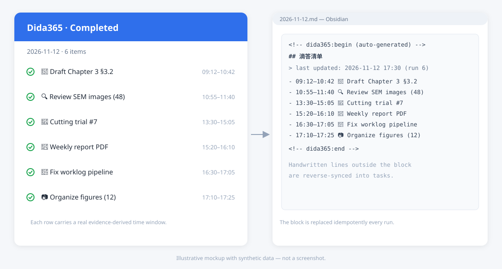

# claude-worklog-dida

Evidence-based daily work journal for [Claude Code](https://claude.com/claude-code): turn what you actually did into **completed tasks in Dida365 (TickTick)** and a **diary block in Obsidian** — automatically, every hour.

> Status: experimental, extracted from a personal daily workflow. Windows-first, Dida365-first. Prompts ship in Chinese and English (`prompt_lang`). See [Limitations](#limitations) before installing.



<sub>Illustrative mockup with synthetic data — not a screenshot.</sub>

```
~/.claude/projects/**/*.jsonl ──┐
                                ├─> Dida365 completed tasks ─> Obsidian diary block
whole-machine file mtimes ──────┘         ^
                                          │
Obsidian handwritten lines ───────────────┘  (reverse sync)
diary blocks of the week ─> structured weekly summary (`<vault>/07-日记/<YYYY>-W<NN>_周总结.md`)
```

Unlike transcript-only loggers, this project also scans **file modification/creation times across your drives** and labels them `[human]` / `[likely automated]`. Work done in Word, Origin, MATLAB, SolidWorks or an editor without Claude still becomes evidence — which is usually the majority of a researcher's day.

## How it works

1. `daily_worklog.ps1` (hourly scheduled task) extracts today's user messages from Claude Code transcripts.
2. `fs_evidence.py` scans file timestamps across configured roots (~1.4M files / ~70 s full scan, then adapts to hot directories).
3. One `claude -p` call reads `worklog_prompt.md` plus the evidence file and writes:
   - new **completed** tasks with real start/end times,
   - reverse-filled tasks from handwritten diary lines,
   - a `## 滴答清单` block in the day's Obsidian note.
4. `weekly_summary.ps1` compresses the week's diary blocks into a seven-section summary; all numbers are computed by `weekly_extract.py`, not by the model.

The design rule: **the orchestrator does no judging; one `claude -p` call does all of it, guided by `worklog_prompt.md`.** Change the rules, not the code.

## Requirements

- Windows 10/11, PowerShell 5.1
- Python 3.8+ (stdlib only — no pip install)
- [Claude Code](https://claude.com/claude-code) CLI, authenticated
- A Dida365/TickTick MCP server authorized in Claude Code (project-level `mcpServers`), so `mcp__dida365__*` tools exist
- An Obsidian vault with daily notes named `YYYY-MM-DD.md`

## Quick start

```bash
git clone <this repo> claude-worklog-dida
cd claude-worklog-dida
cp config.example.json config.json
# edit config.json: vault path and dida.mcp_key
```

Find the MCP key: in `~/.claude/.credentials.json`, under `mcpOAuth`, the key looks like `dida365|<id>`. Put that whole string in `config.json` as `dida.mcp_key` (or set `WORKLOG_DIDA_MCP_KEY`).

Verify the task-manager bridge:

```bash
python3 scripts/tools/dida_mcp_http.py list_projects '{}'
```

Then dry-run (no model call, no writes):

```powershell
powershell.exe -NoProfile -File scripts/daily_worklog.ps1 -DryRun
powershell.exe -NoProfile -File scripts/weekly_summary.ps1 -WeekEnd <any-day-of-week> -DryRun
```

Register the scheduled tasks (idempotent):

```powershell
powershell.exe -NoProfile -File scripts/register_worklog_task.ps1
powershell.exe -NoProfile -File scripts/register_weekly_task.ps1
```

## Configuration

All paths accept `~` and environment variables. See `config.example.json`.

| Key | Meaning |
|:---|:---|
| `vault` | Obsidian vault root |
| `daily_note_dir` | Where daily notes live (root recommended; `legacy_daily_dir` is a read fallback) |
| `weekly_dir` | Output directory for weekly summaries |
| `claude_projects` | Claude Code transcripts directory (default `~/.claude/projects`) |
| `scan_roots` | Drives to scan for file evidence; empty = `C:`, `D:`, `E:` if they exist |
| `scan_skip` | Extra absolute prefixes to skip |
| `tz_offset` | Offset used in task timestamps (DeepSeek billing is Beijing time: `+0800`) |
| `dida.credentials` / `dida.mcp_key` | Where to read the MCP OAuth token from |
| `dida.inbox_project_id` / `dida.inbox_column_id` | Inbox ids written into new tasks (find them in any existing task payload) |
| `task_tools.list_completed` / `add` / `update` | MCP tool names rendered into the prompt |
| `prompt_lang` | `zh` (default) or `en` — selects `worklog_prompt.<lang>.md` / `weekly_prompt.<lang>.md` |
| `claude.command` | `claude` CLI path/name |
| `claude.cost_script` | Optional CNY cost meter; leave empty to skip cost logging |
| `schedule.task_folder` | Scheduled-task folder (default `\个人自动化\`) |

## Adapters / other task managers

The judging rules live in Markdown and contain placeholders that `render_prompt.py` fills from `config.json` at run time:

```
{{LIST_COMPLETED}} {{ADD_TASKS}} {{UPDATE_TASKS}}
{{INBOX_PROJECT_ID}} {{INBOX_COLUMN_ID}} {{TIMEZONE}} {{TZ_OFFSET}}
```

To target another MCP task backend: set `task_tools.*` to its tool names, fill the two inbox ids, and adjust the backend-specific notes in the prompt (two-step completion, `columnId`, status values). Dida365 is the only backend exercised so far; Todoist/Notion are **not** supported out of the box.

## Cost

Each hourly run with new activity calls the model once: roughly ¥0.15–0.5 on DeepSeek, ~¥0.23 for a weekly summary. Idle hours exit before the model call (after the filesystem scan). There is **no per-day run cap** — re-runs are idempotent, but frequent activity means more calls.

## Privacy

Evidence sent to the model includes your prompts, file names/paths and diary text. Nothing else leaves the machine; there is no telemetry. `data/`, `logs/` and `config.json` are git-ignored. Run with `-DryRun` first to inspect exactly what would be sent.

## Limitations

- **Windows only** for the orchestration (PowerShell + Task Scheduler). The Python pieces are portable.
- **Dida365 only** out of the box; the MCP tool whitelist is hardcoded in `daily_worklog.ps1`.
- Prompts are Chinese; task categories and emoji rules assume a Chinese workflow.
- Only covers work with local traces (Claude sessions or file changes). Meetings, reading and phone work are invisible unless written into the diary.
- Claude Code transcripts are retained ~30 days; gaps longer than that cannot be backfilled.

## Layout

```
scripts/
  daily_worklog.ps1      hourly orchestrator
  weekly_summary.ps1     weekly orchestrator
  worklog_extract.py     transcripts -> evidence
  fs_evidence.py         whole-machine file changes -> evidence
  worklog_prompt.zh.md   ALL judging rules (the actual product)
  worklog_prompt.en.md   English translation of the same rules
  weekly_prompt.zh.md    weekly writing rules
  weekly_prompt.en.md    English translation
  render_prompt.py       fills backend placeholders from config.json
  dida_to_obsidian.py    tasks -> diary block
  obsidian_to_dida.py    diary lines -> tasks (reverse sync)
  weekly_extract.py      week evidence + program-computed stats
  register_*.ps1         scheduled-task registration
  wl_config.py/.ps1      shared config loader
  tools/                 MCP HTTP bridge, task audit, BOM helper
```

## License

MIT — see [LICENSE](LICENSE).
