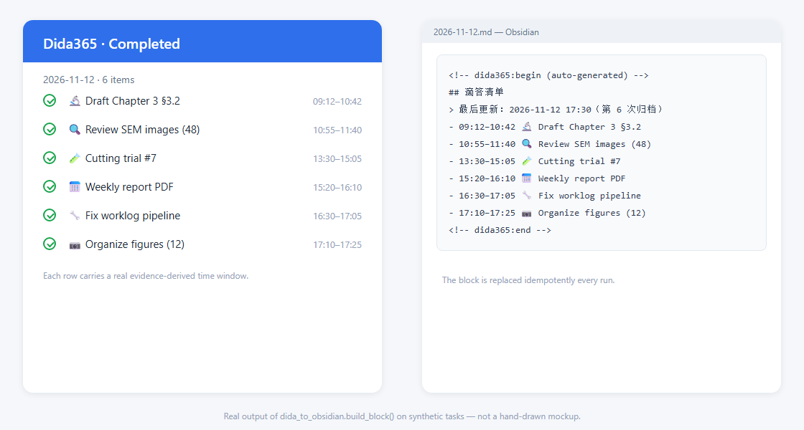

# claude-worklog-dida

[](https://github.com/yanghaod2278827/claude-worklog-dida/actions/workflows/tests.yml)

面向 [Claude Code](https://claude.com/claude-code) 的**证据驱动工作日志**：把「你实际做了什么」自动变成**滴答清单里的已完成任务**和 **Obsidian 日记块**，每小时跑一次。

> 状态：实验性项目，从个人日常流程中抽离。Windows 优先、滴答优先；提示词中英双语（`prompt_lang`）。安装前请先看[已知局限](#已知局限)。



<sub>截图来源：用合成任务调用真实的 `dida_to_obsidian.build_block()` 后渲染（`docs/make_demo.py`），不是手绘图。</sub>

```
~/.claude/projects/**/*.jsonl ──┐
                                ├──> 滴答已完成任务 ──> Obsidian 日记块
全机文件 mtime / 创建时间 ──────┘          ^
                                          │
Obsidian 手写行 ───────────────────────────┘  （反向补录）
一周日记块 ──> 结构化周总结（<vault>/07-日记/<YYYY>-W<NN>_周总结.md）
```

与「只读转录」的日志工具不同，本项目还会扫描**全盘文件改动时间**并标注 `[人为]` / `[疑似自动]`。在 Word、Origin、MATLAB、SolidWorks 里干的活，即使没经过 Claude，也会成为证据——这通常是研究者一天里最主要的部分。

## 工作方式

1. `daily_worklog.ps1`（每小时计划任务）抽取当天 Claude Code 转录里的用户输入。
2. `fs_evidence.py` 扫描配置的根目录（全盘约 1.38M 文件 / 约 70 秒，之后自适应到常用目录）。
3. 一次 `claude -p` 调用读取 `worklog_prompt.md` 与证据文件，完成：新建带真实起止时间的**已完成任务**、从日记手写行**反向补录**、写当天日记的 `## 滴答清单` 块。
4. `weekly_summary.ps1` 把一周的日记块压成七节总结；**数字全部由 `weekly_extract.py` 算**，模型只负责写。

设计原则：**编排脚本不做判断，全部判断交给一次 `claude -p`，规则集中在 `worklog_prompt.md`**。改规则不改代码。

## 前置条件

- Windows 10/11 + PowerShell 5.1
- Python 3.8+（纯标准库，不需要 pip）
- 已登录的 [Claude Code](https://claude.com/claude-code) CLI
- 在 Claude Code 里授权过滴答清单 MCP（项目级 `mcpServers`），存在 `mcp__dida365__*` 工具
- Obsidian vault，日记命名为 `YYYY-MM-DD.md`

## 快速开始

```bash
git clone <this repo> claude-worklog-dida
cd claude-worklog-dida
cp config.example.json config.json
# 编辑 config.json：vault 路径与 dida.mcp_key
```

找 MCP key：在 `~/.claude/.credentials.json` 的 `mcpOAuth` 下，键形如 `dida365|<id>`，整串填进 `config.json` 的 `dida.mcp_key`（或设环境变量 `WORKLOG_DIDA_MCP_KEY`）。

验证桥接：

```bash
python3 scripts/tools/dida_mcp_http.py list_projects '{}'
```

先干跑（不调模型、不写任务）：

```powershell
powershell.exe -NoProfile -File scripts/daily_worklog.ps1 -DryRun
powershell.exe -NoProfile -File scripts/weekly_summary.ps1 -WeekEnd <该周任意一天> -DryRun
```

注册计划任务（幂等）：

```powershell
powershell.exe -NoProfile -File scripts/register_worklog_task.ps1
powershell.exe -NoProfile -File scripts/register_weekly_task.ps1
```

## 配置

所有路径支持 `~` 与环境变量，见 `config.example.json`。

| 键 | 含义 |
|:---|:---|
| `vault` | Obsidian vault 根目录 |
| `daily_note_dir` | 日记目录（建议根目录；`legacy_daily_dir` 只读回退） |
| `weekly_dir` | 周总结输出目录 |
| `claude_projects` | Claude Code 转录目录（默认 `~/.claude/projects`） |
| `scan_roots` | 文件证据扫描盘符；留空 = 存在的 `C:`/`D:`/`E:` |
| `scan_skip` | 额外跳过的绝对路径前缀 |
| `tz_offset` | 任务时间戳时区偏移（DeepSeek 计费为北京时间：`+0800`） |
| `dida.credentials` / `dida.mcp_key` | MCP OAuth token 的读取位置 |
| `dida.inbox_project_id` / `dida.inbox_column_id` | 新建任务写入的 Inbox ids（可从任一已有任务的返回体里找到） |
| `task_tools.list_completed` / `add` / `update` | 渲染进提示词的 MCP 工具名 |
| `prompt_lang` | `zh`（默认）或 `en`，选择 `worklog_prompt.<lang>.md` / `weekly_prompt.<lang>.md` |
| `claude.command` | `claude` 可执行文件 |
| `claude.cost_script` | 可选的人民币花费统计脚本；留空则不记花费 |
| `schedule.task_folder` | 计划任务所在文件夹（默认 `\个人自动化\`） |

## 适配其他任务管理器

判断规则全在 Markdown 里，其中与后端相关的字符串是占位符，由 `render_prompt.py` 在运行时从 `config.json` 填入：

```
{{LIST_COMPLETED}} {{ADD_TASKS}} {{UPDATE_TASKS}}
{{INBOX_PROJECT_ID}} {{INBOX_COLUMN_ID}} {{TIMEZONE}} {{TZ_OFFSET}}
```

要换成别的 MCP 任务后端：把 `task_tools.*` 改成对应工具名、填两个 Inbox id，再按后端调整提示词里的后端细节（两步置完成、`columnId`、status 取值）。目前只实测过滴答清单；Todoist / Notion **尚未支持**。

## 花费

有新增活动时每轮调用一次模型：DeepSeek 上约 ¥0.15–0.5，周总结约 ¥0.23。空闲轮在调模型前就退出（但文件扫描已跑完）。**没有每日次数上限**——重跑幂等，但活动多就花得多。

## 隐私

发给模型的证据包含你的输入、文件名/路径和日记文字；除此之外没有任何数据离开本机，项目不含遥测。`data/`、`logs/`、`config.json` 已被 git 忽略。建议先 `-DryRun` 看清到底会发什么。

## 已知局限

- **编排层仅 Windows**（PowerShell + 任务计划）；Python 部分可移植。
- 默认只接**滴答清单**；MCP 工具白名单写死在 `daily_worklog.ps1`。
- 提示词为中文，类目/emoji 规则按中文工作流设计。
- 只覆盖有本地痕迹的工作（Claude 会话或文件改动）；开会、阅读、电话除非写进日记，否则抓不到。
- Claude Code 转录只保留约 30 天，超过一个月的空档补不回来。

## 故障排查：老任务被记成「今天完成」

日记块里出现一条**没有时刻前缀、标题却像几个月前的旧待办**时，多半不是本工具编的，而是任务的 `completedTime` 被别的客户端改成了「现在」：

- **成因（实测）**：Obsidian 的 DidaSync 插件(v1.7.6) `updateTaskInDidaList()` 末尾有 `if (task.status === 2) await completeTaskInDida(task)` —— 每重推一次**已完成**任务就调一次 `POST /project/{id}/task/{id}/complete`，服务端把 `completedTime` 刷成当前时刻。它的「反向完成」记账会把不在远端**活跃列表**里的任务（即所有已完成任务）重新推一遍，于是旧任务周期性以「今天完成」的身份出现。
- **判定**：`completedTime` 明显晚于 `createdTime`/`dueDate`（如 7 月建、今天「完成」），且该任务 `content` 为空的手建任务；DidaSync 的 `data.json` 里对应条目有 `reverseCompletionMeta[<didaId>].lastMissingAt` 与完成时间只差几秒。
- **修复**（把完成时间改回原计划日，默认只读）：

```bash
python3 scripts/tools/fix_task_completed_time.py --date 2026-11-18 --title 关键字        # 看
python3 scripts/tools/fix_task_completed_time.py --date 2026-11-18 --title 关键字 --apply # 改
```

改完下一轮就会自动从当日日记块里掉出去；历史日期的日记块要手改。**注意 MCP 的 `list_completed_tasks_by_date` 未必按 `fromDate/toDate` 过滤**，复核时以「当前列表里还有没有它」为准。

提示词里另有一条**异常任务护栏**：`createdTime` 比 `completedTime` 早 30 天以上、`content` 为空、当天证据又对不上的任务，会被判为异常——不改字段、不进日记块，只在日志里打 `WARN anomaly=N`（明细落 `data/anomalies_<日期>.txt`）与 `ANOMALY: <id> | <标题> | created=… completed=…` 行，等你用上面的命令修。

## 目录

```
scripts/
  daily_worklog.ps1      每小时编排
  weekly_summary.ps1     每周编排
  worklog_extract.py     转录 -> 证据
  fs_evidence.py         全机文件改动 -> 证据
  worklog_prompt.zh.md   全部判断规则（真正的核心资产）
  worklog_prompt.en.md   同一套规则的英文版
  weekly_prompt.zh.md    周总结写作规则
  weekly_prompt.en.md    英文版
  render_prompt.py       用 config.json 填充后端占位符
  dida_to_obsidian.py    任务 -> 日记块
  obsidian_to_dida.py    日记手写行 -> 任务（反向）
  weekly_extract.py      周证据 + 程序统计
  register_*.ps1         计划任务注册
  wl_config.py/.ps1      共享配置加载
  tools/                 MCP HTTP 桥、任务审计、BOM 工具、selftest、完成时间修正
docs/
  make_demo.py           用真实 build_block 输出重生成截图
  demo-diary.png         已提交的截图
```

## 许可证

MIT，见 [LICENSE](LICENSE)。
